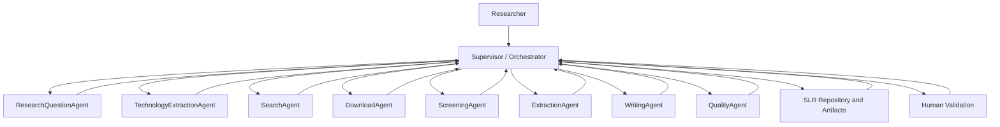

# SLRResearchAI

### An Intelligent, Controlled and Evidence-Based Multi-Agent System for Systematic Literature Reviews

---

## Overview

**SLRResearchAI** is an intelligent multi-agent platform designed to assist researchers in conducting Systematic Literature Reviews (SLRs), from research question formulation and scientific literature retrieval to evidence extraction, synthesis and report generation.

The platform combines specialized AI agents, scientific databases, structured workflows, evidence traceability, quality evaluation and human oversight to support a more reproducible, transparent and controlled SLR process.

Rather than relying on a single AI model to perform the entire review, SLRResearchAI follows a modular multi-agent architecture in which specialized agents handle distinct tasks and a centralized orchestrator controls workflow execution, state transitions, validation and agent coordination.

> **Project status:** Architecture and foundations phase. The system is currently under development.

---

## Objectives

- Assist researchers throughout the SLR process.
- Generate and refine research questions.
- Identify research concepts, technologies, tasks and contexts.
- Build and execute scientific search strategies.
- Retrieve and manage scientific papers from multiple sources.
- Detect and manage duplicate publications.
- Acquire and process accessible full-text documents.
- Assist with systematic screening.
- Extract structured research data and evidence.
- Generate evidence-based scientific synthesis.
- Evaluate the quality, coverage and grounding of outputs.
- Preserve traceability and reproducibility.
- Integrate human validation at critical stages.

---

## Proposed Architecture

SLRResearchAI follows a centralized and controlled multi-agent architecture.



The orchestrator manages the workflow, maintains shared state, validates agent results, controls permissions and decides which step should be executed next.

Agents do not freely control the entire workflow. They operate within defined responsibilities, contracts and execution limits.

---

## Specialized Agents

| Agent                         | Responsibility                                                                                                                  |
| ----------------------------- | ------------------------------------------------------------------------------------------------------------------------------- |
| **ResearchQuestionAgent**     | Generates, structures and evaluates candidate research questions based on the research topic and objectives.                    |
| **TechnologyExtractionAgent** | Extracts research concepts, technologies, tasks, contexts, dimensions and related terminology from approved research questions. |
| **SearchAgent**               | Constructs search queries, searches scientific sources and adaptively improves retrieval within controlled limits.              |
| **DownloadAgent**             | Acquires accessible full-text papers, validates files and manages acquisition status.                                           |
| **ScreeningAgent**            | Evaluates studies against predefined inclusion and exclusion criteria and provides evidence-based decisions.                    |
| **ExtractionAgent**           | Extracts structured data and evidence from selected studies according to the extraction schema.                                 |
| **WritingAgent**              | Organizes evidence, compares studies and generates evidence-based synthesis and report sections.                                |
| **QualityAgent**              | Evaluates evidence grounding, coverage, consistency, artifact integrity and synthesis quality.                                  |

---

## Orchestration

The platform uses a centralized Supervisor / Orchestrator responsible for:

- Managing workflow state.
- Controlling stage transitions.
- Validating agent outputs.
- Managing execution budgets and retries.
- Handling failures and recovery.
- Enforcing agent permissions.
- Triggering human review.
- Tracking execution and artifacts.
- Managing workflow completion or escalation.

The orchestration strategy will be evaluated before its final implementation.

---

## Workflow

The proposed workflow is:

1. Research question generation and validation.
2. Research concepts and terminology extraction.
3. Scientific literature search.
4. Paper metadata normalization and deduplication.
5. Full-text acquisition.
6. Title and abstract screening.
7. Full-text screening.
8. Structured data extraction.
9. Evidence organization and synthesis.
10. Quality evaluation.
11. Report generation and validation.

The workflow may include controlled retries, revisions, validation gates and human review.

---

## Candidate Technologies

The following technologies are candidates for the architecture and will be evaluated during development.

| Area                          | Candidate Technologies                               |
| ----------------------------- | ---------------------------------------------------- |
| Programming Language          | Python                                               |
| Structured Data and Contracts | Pydantic                                             |
| Agent Orchestration           | LangGraph or a controlled custom orchestration layer |
| Scientific APIs               | OpenAlex, Crossref, Semantic Scholar                 |
| Document Processing           | PyMuPDF, GROBID and evaluated alternatives           |
| Retrieval                     | Lexical, semantic and hybrid retrieval               |
| Backend API                   | FastAPI                                              |
| Testing                       | Pytest                                               |
| Database                      | Relational database to be selected                   |
| Document Storage              | File or object storage                               |
| Deployment                    | Docker                                               |
| Monitoring and Tracing        | To be evaluated                                      |

Final technology selection will be based on technical evaluation, reliability, reproducibility, maintainability and project requirements.

---

## Scientific and Methodological Principles

The platform is designed around the following principles:

- **Protocol-driven reviews:** The review process follows a predefined and versioned protocol.
- **Evidence-based outputs:** Research claims must be supported by traceable evidence.
- **Reproducibility:** Search strategies, decisions, configurations and artifacts are recorded.
- **Transparency:** Agent decisions and workflow transitions are traceable.
- **Human oversight:** Researchers remain responsible for validation and scientific decisions.
- **Bounded autonomy:** Agent execution is limited by explicit permissions, budgets and stopping conditions.
- **Quality evaluation:** Agents and workflows are tested and evaluated using defined criteria.
- **Modularity:** Components can be developed, evaluated and replaced independently.

Methodological references will include appropriate systematic review guidelines and frameworks, depending on the review type and research domain.

---

## Project Structure

The initial repository structure is designed to separate agents, orchestration, tools, models, services, storage, testing and documentation.

```text
SLRResearchAI/
│
├── src/
│   ├── agents/
│   ├── orchestration/
│   ├── tools/
│   ├── models/
│   ├── services/
│   ├── storage/
│   └── utils/
│
├── tests/
│   ├── unit/
│   ├── integration/
│   └── evaluation/
│
├── docs/
│   ├── architecture/
│   ├── methodology/
│   └── decisions/
│
├── data/
│   ├── raw/
│   ├── processed/
│   └── artifacts/
│
├── logs/
├── .gitignore
└── README.md
```

The structure will evolve as the architecture and implementation become more mature.

---

## Development Roadmap

### Phase 0 — Methodology and Workflow Specification

- Define the SLR methodology.
- Define the review protocol.
- Define workflow stages and transitions.
- Define validation and approval gates.
- Define agent responsibilities and contracts.

### Phase 1 — Architecture and Foundations

- Repository setup.
- Python environment.
- Configuration management.
- Logging.
- Structured data contracts.
- Persistence design.
- Testing foundations.

### Phase 2 — Research Question and Vocabulary Agents

- ResearchQuestionAgent.
- TechnologyExtractionAgent.
- Structured outputs.
- Validation and human approval.

### Phase 3 — Scientific Search

- Scientific source integrations.
- Query generation.
- Search execution.
- Metadata normalization.
- Deduplication.
- Adaptive search strategy.
- Search evaluation.

### Phase 4 — Acquisition and Document Processing

- Full-text acquisition.
- File validation.
- Document parsing.
- Document storage.
- Parsing evaluation.

### Phase 5 — Screening

- Title and abstract screening.
- Full-text screening.
- Inclusion and exclusion criteria.
- Evidence-based decisions.
- Human review.

### Phase 6 — Data Extraction

- Extraction schema.
- Evidence extraction.
- Source locations.
- Data validation.

### Phase 7 — Synthesis and Quality

- Evidence organization.
- Claim generation.
- Evidence-grounded synthesis.
- QualityAgent.
- Report generation.
- Quality evaluation.

### Phase 8 — Integration and Deployment

- Full workflow integration.
- API.
- Interface.
- Docker.
- Monitoring.
- End-to-end testing.
- Reproducible deployment.

---

## Research Integrity and Limitations

SLRResearchAI is designed to assist researchers, not replace scientific judgment.

The platform will:

- Preserve uncertainty instead of forcing unsupported decisions.
- Distinguish unavailable documents from excluded studies.
- Record screening decisions and reasons.
- Avoid fabricating references or evidence.
- Respect API terms, access restrictions and document rights.
- Provide traceable evidence for extracted information and generated claims.
- Allow human review of ambiguous or critical decisions.

The reliability of the system will be evaluated rather than assumed.

---

## Project Development

The project will be developed incrementally.

Each component will be designed, implemented, tested and evaluated before being integrated into the complete workflow.

The TD01–TD09 projects serve as technical and conceptual references for the implementation and evaluation of methods, but SLRResearchAI will be designed as an independent, integrated architecture.

---
